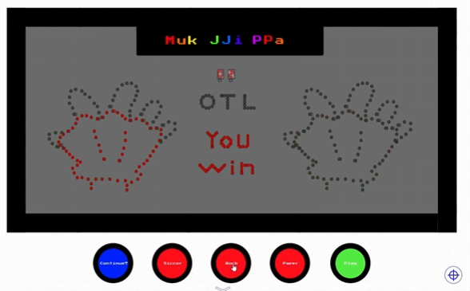
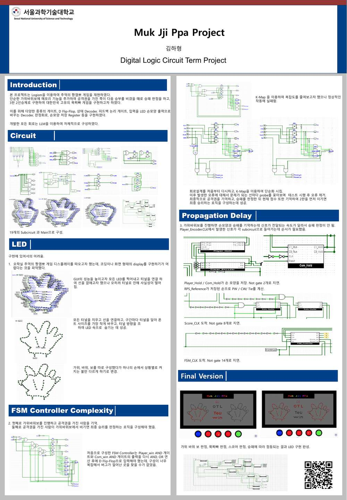
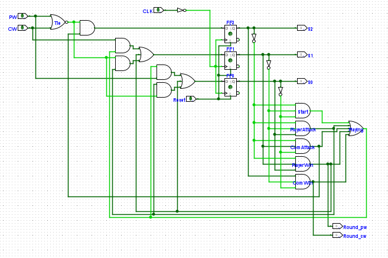
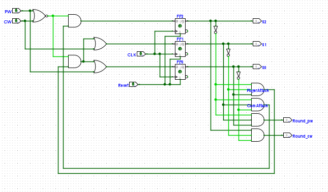

# 묵찌빠 — Digital Logic Circuit Term Project

**2025년 2학기 · 디지털논리시스템 · 개인 텀프로젝트 · Logisim-evolution · 만점**

> 교수님은 “단순한 가위바위보를 만들면 최하점”이라고 말씀하셨습니다.  
> 저는 그 말을 듣고 **가위바위보를 더 복잡한 게임으로 발전시키면 어떨까?** 생각했습니다.

그렇게 시작한 것이 **공격권을 기억하는 묵찌빠**입니다. 가위바위보의 승패 판정을 바탕으로, **공격권 저장 → 묵찌빠 라운드 판정 → 점수 누적 → 3판 2선승**까지 구현했습니다. LED를 일일이 배치해 손 모양과 오락기 화면도 직접 만들었습니다.

## 실제 작품

  
  

**[시연 영상 — 발표 포스터의 QR 링크](https://scanned.page/kI0vRq)** · **[발표 포스터 PDF 열기](docs/submission/poster.pdf)** · [실행용 Logisim 회로](circuit/mukjjippa-main.circ)

위 이미지는 제가 구현한 **실제 Logisim 회로의 게임 화면**입니다. 시연 영상 링크는 발표 포스터에 인쇄한 QR 코드의 주소입니다.

### 발표 포스터

회로의 구성, LED 디스플레이, FSM 재설계, 클록 지연 문제, 최종 결과를 한 장에 정리한 제출 포스터입니다.

  

[포스터 PDF 원본 보기](docs/submission/poster.pdf) · [편집용 PPTX](docs/submission/poster.pptx)

## 왜 이 주제를 선택했나?

텀프로젝트는 주제와 난이도가 자유로웠지만, 교수님은 **하루 만에 만들 수 있는 수준이 아니라 공부와 노력이 드러나는 작품**을 원하셨습니다. 단순 가위바위보 구현은 최하점 수준이라는 설명을 들었을 때, 저는 반대로 가위바위보에서 출발해 수업에서 배운 내용을 더 많이 담아 볼 수 있겠다고 생각했습니다.

일반 가위바위보는 두 손을 비교하는 **조합논리**만으로 승패를 결정할 수 있습니다. 하지만 묵찌빠는 **직전에 누가 공격권을 얻었는지 기억**해야 합니다. 공격권을 가진 쪽이 비겼을 때만 라운드가 종료되고, 각 라운드의 승점을 기억해 **2승을 먼저 얻은 쪽**을 최종 승자로 정해야 합니다.

즉, 가위바위보를 발전시키는 과정에서 **논리 게이트·D Flip-Flop·FSM·Register·Decoder·Counter**를 활용할 수 있었습니다.

## 주요 회로와 역할

| 기능 | 서브회로 | 설계 이유 |
| --- | --- | --- |
| 플레이어·컴퓨터의 손 선택 | `Player_Encoder`, `Comp_RNG` | 입력을 통일된 2비트 손 정보로 변환 |
| 선택한 손 기억 | `Player_Hold`, `Com_Hold` | 판정이 진행되는 동안 입력을 유지 |
| 가위바위보 판정 | `RPS_Reference` | 승·패·비김 신호를 분리 |
| 공격권 및 라운드 상태 | `FSM_Controller` | **이전 공격권을 기억해** 비김을 라운드 승리로 판정 |
| 승점 누적 및 최종 승리 | `Score_Counter` | 2선승 결과까지 기억 |
| 손 모양과 승패 표시 | `Display_Controller`, `Blink_Gen`, `Main` | 회로 결과를 LED 게임 화면에 표현 |

**[각 서브회로의 구현과 설계 이유 자세히 보기](docs/implementation.md)**

## 가장 어려웠던 부분

### FSM을 처음부터 다시 만들다

단순 가위바위보는 정상 작동했지만, 처음에는 공격권을 기억한 상태에서 비겼을 때 라운드 승리가 판정되지 않았습니다. 기존 FSM은 AND·OR 게이트 연결이 복잡해 문제 지점을 찾기가 어려웠습니다.

이 문제로 **하루 약 2시간씩 열흘 넘게** 고민했습니다. 최종적으로 **K-Map으로 논리식을 단순화해 FSM을 다시 구성**하고, 각 신호에 **Probe를 연결해 오류를 추적**했습니다.

| 초기 FSM | 재설계한 FSM |
| --- | --- |
|  |  |

### 회로는 값뿐 아니라 순서도 중요했다

손 모양을 저장하는 시점, 승패를 판정하는 시점, 점수를 올리는 시점이 맞지 않아 점수가 `0 → 1 → 3`처럼 건너뛰는 문제가 생겼습니다.

저장 경로와 점수·FSM 클록 경로의 **전파 지연을 조절**하면서 해결했습니다. 논리식이 맞더라도 신호가 도착하는 순서가 다르면 결과가 달라진다는 것을 경험했습니다.

### LED로 직접 그린 게임 화면

원하던 오락실 화면을 이미지로 그대로 가져올 수 없어, **Main 화면에 LED 327개를 배치**해 손 모양과 승패 표시를 만들었습니다. 신호선과 Tunnel의 위치도 조절해 회로와 게임 화면이 함께 읽히도록 다듬었습니다.

[**설계·디버깅 과정 더 읽기**](docs/retrospective.md)

## 실행 방법

GitHub에서는 `.circ` 파일을 바로 실행할 수 없습니다. 원본을 직접 조작하려면 다음 방법을 사용합니다.

1. [Logisim-evolution 3.9.0](https://github.com/logisim-evolution/logisim-evolution/releases/tag/v3.9.0) 설치
2. [묵찌빠 실행용 회로 다운로드](circuit/mukjjippa-main.circ)
3. Logisim에서 파일을 열고 `Main`의 가위·바위·보 및 게임 진행 버튼 조작

[2025년 회로 원본](archive/kim_hahyeong_original.circ)도 함께 보관했습니다. 실행용 파일은 프로젝트의 시작 화면만 `Main`으로 변경한 사본입니다.

---

**결과: 디지털논리시스템 텀프로젝트 만점**  
**기술:** Logisim-evolution · Combinational Logic · FSM · D Flip-Flop · Counter · Decoder · LED
