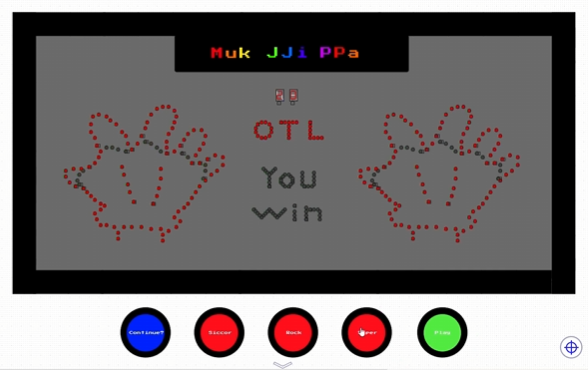
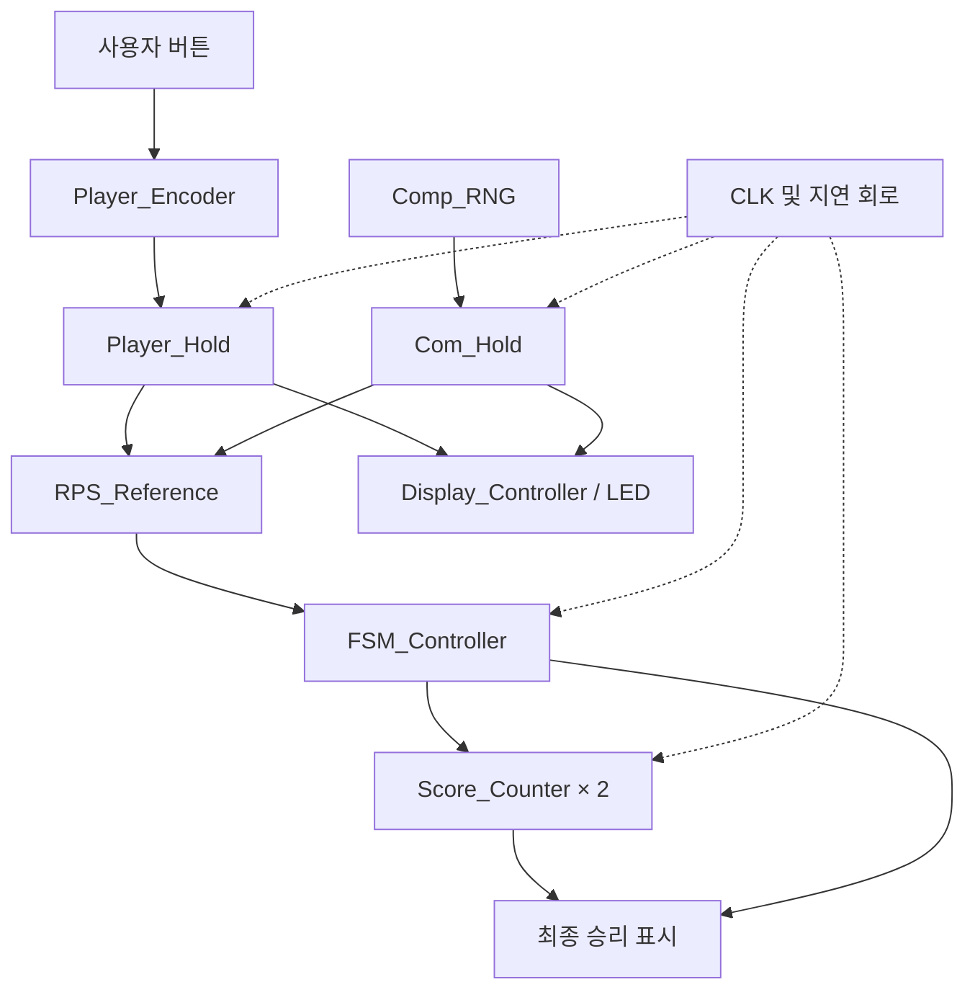

# 묵찌빠 — Digital Logic Circuit Term Project

**2025년 2학기 · 디지털논리시스템 · 개인 텀프로젝트 · Logisim-evolution**

> **가위바위보의 승패만 계산하는 회로를 넘어, 누가 공격권을 가졌는지 기억하고, 비겼을 때 라운드 승패를 확정하며, 먼저 2승을 거둔 쪽의 최종 승리를 판정하는 묵찌빠 게임**을 디지털 논리회로로 구현했습니다.

  
  

**핵심:** 순차논리(FSM·D Flip-Flop), 조합논리(승패 비교·Decoder), 점수 카운터, LED 디스플레이, 신호 전달 순서 디버깅을 하나의 게임으로 연결했습니다.

## 🕹️ 회로 열기

**[▶ Logisim 회로 파일 — Main 화면으로 시작](circuit/mukjjippa-main.circ)** · [2025년 제출 당시 원본](archive/kim_hahyeong_original.circ) · [프로젝트 포스터 PDF](docs/submission/poster.pdf)

1. [Logisim-evolution](https://github.com/logisim-evolution/logisim-evolution/releases/tag/v3.9.0) **3.9.0**을 설치합니다.
2. `circuit/mukjjippa-main.circ`를 다운로드하고 Logisim-evolution으로 엽니다.
3. `Main` 화면에서 가위·바위·보 버튼 및 게임 진행 버튼을 조작합니다. 시뮬레이션이 정지되어 있으면 활성화하고, 필요에 따라 Tick 기능을 조정합니다.
4. 손 모양 LED, 공격권, 라운드 점수 및 최종 승리 표시의 변화를 관찰합니다.

> **2026년 아카이브 참고:** 원본 파일의 프로젝트 기본 시작 회로는 `RPS_Reference_rip`으로 지정되어 있습니다. 포트폴리오에서 쉽게 열 수 있도록 `Main`을 기본 시작 회로로 **지정하는 한 줄만 변경한 사본**을 위에 제공했습니다. 나머지 회로 구성은 유지했습니다. 원본 그대로 열 경우 왼쪽 회로 목록에서 `Main`을 선택하세요. 이번 정리에서는 XML 구조 검사까지 수행했으며, **Logisim GUI를 직접 조작하는 전체 게임 실행 검증은 완료하지 못했습니다.**

## 01. 무엇을 만들었나

묵찌빠는 일반 가위바위보와 달리 **이전 승부에서 획득한 공격권을 기억해야 하는 게임**입니다. 공격권을 가진 쪽이 다음 가위바위보에서 비기면 그쪽이 라운드를 승리합니다. 프로젝트는 이를 **3판 2선승제** 게임으로 확장해 점수 누적 및 최종 결과 표시를 목표로 했습니다.

- 사용자: 가위·바위·보 입력 버튼
- 컴퓨터: 회로 내부의 수 선택 신호 발생기(`Comp_RNG`)
- 판정: 가위바위보 승패와 비김 여부(`RPS_Reference`)
- 기억: 선택한 손과 공격권을 유지하는 D 플립플롭 및 상태 회로
- 결과: 점수 누적, 2승 판정, LED 손 모양과 승패 메시지 점등

## 02. 구현 구조

| 핵심 회로 | 실제 원본에서 확인되는 역할 |
| --- | --- |
| `Player_Encoder` | 버튼 입력을 2비트 손 모양 코드와 이벤트 CLK로 변환 |
| `Comp_RNG` | 컴퓨터 측 손 모양 선택을 위한 신호 생성 |
| `Player_Hold` / `Com_Hold` | 선택한 손을 D Flip-Flop으로 유지 |
| `RPS_Reference` | Player Win / Computer Win / Tie 신호 판정 |
| `FSM_Controller` | 공격권·비김·라운드 종료에 관한 상태 및 결과 신호 처리 |
| `Score_Counter` | 라운드 승리를 누적하여 2승 달성 여부 출력 |
| `Display_Controller` | 손 모양 코드를 LED 표시용 신호로 변환 |
| `Blink_Gen` | 점멸 표현을 위한 상태 기반 출력 생성 |
| `Main` | 게임 화면과 전체 서브회로 연결 |

**코드 규약:** 당시 설계 메모에는 가위 `01`, 바위 `10`, 보 `11`의 2비트 표현을 사용했다고 기록되어 있습니다. 실제 신호 연결의 상세 내용은 원본 회로 파일을 기준으로 확인하세요.

[**회로별 설명과 데이터 흐름 상세**](docs/implementation.md)

## 03. 가장 어려웠던 부분

### FSM의 복잡도

단순 가위바위보 승패 회로는 동작했지만, 공격권을 기억하고 비김과 결합하는 과정에서 **묵찌빠의 라운드 판정이 작동하지 않는 문제**가 발생했습니다. 복잡한 첫 설계 대신 **K-Map으로 논리를 단순화한 FSM 회로**를 다시 만들고, 입력·출력에 Probe를 연결해 신호를 하나씩 추적했습니다.

### 신호 전달 시점

사용자 입력 이후 손 모양 저장, 승패 판정, 점수 반영, FSM 전이가 서로 다른 시점에 일어나면서 **승패 및 점수 오동작**이 발생했습니다. 포스터에는 NOT 게이트를 활용해 신호 경로의 지연을 조정한 기록이 남아 있습니다. 이는 당시 시뮬레이터에서 찾은 해결 과정이며, 모든 실제 하드웨어에서 안전한 클록 설계라고 일반화하지 않습니다.

### LED로 직접 구현한 화면

완성된 디스플레이를 가져오기보다 **LED를 하나씩 배치해 손 모양과 게임 화면을 구성**했습니다. 선과 Tunnel이 화면에 드러나는 문제를 조정하면서, 최종적으로 버튼·손 모양·결과 표시를 한 화면에 배치했습니다.

[**실제 시행착오와 2026년 회고**](docs/retrospective.md)

## 04. 포스터 및 제출 자료

| 자료 | 내용 |
| --- | --- |
| [Logisim 회로 (실행용)](circuit/mukjjippa-main.circ) | 시작 회로를 `Main`으로 설정한 2026년 편의 사본 |
| [Logisim 회로 (2025년 원본)](archive/kim_hahyeong_original.circ) | 당시 제출 파일의 내용 그대로 보존 |
| [발표 포스터 PDF](docs/submission/poster.pdf) | 회로 구성·문제 해결·최종 화면 |
| [포스터 PPTX](docs/submission/poster.pptx) | 편집 가능한 발표 원본 |
| [개인 보고서 PDF](docs/submission/reflection.pdf) | 당시 시행착오와 성찰 기록 |
| [개인 보고서 DOCX](docs/submission/reflection.docx) | 편집 가능한 보고서 원본 |
| [2026년 정적 검증 기록](docs/verification.md) | 회로 파일 구조와 보존 상태에 대한 검증 |

> **영상:** 2025년 당시 영상도 제출한 것으로 보고서에 기록되어 있지만, 이번에 제공된 파일에는 **동영상 자체가 포함되지 않았습니다.** 이후 원본을 찾으면 별도로 보존하고 README에 연결할 수 있습니다. 포스터의 QR 코드는 실제 영상으로 연결되는지 확인되지 않아 현재 README에 링크하지 않았습니다.

## 05. 이 프로젝트에서 배운 것

처음에는 가위바위보의 승패 판정만 만들면 끝날 것처럼 보였습니다. 하지만 묵찌빠의 **‘이전 결과를 기억한다’는 요구사항**이 추가되자, 회로는 조합논리에서 순차논리 문제로 확장됐습니다. 실제로 구현하는 과정에서 FSM을 나누고, K-Map으로 줄이고, Probe로 관찰하며, 신호가 언제 저장·판정되는지를 확인해야 했습니다.

회로 설계 과정에서 **LLM을 참고하고 적극적으로 활용**했습니다. 동시에 LED 배치, 서브회로 구성, 오류 추적, 재설계는 당시 제출 자료에 남아 있는 실제 작업 과정입니다. **LLM의 도움을 받았다는 사실과 직접 검증한 범위를 구분**하여 기록합니다.

이 저장소는 **2025년 수업 결과물에 2026년의 기술적 검토와 문서화를 덧붙인 아카이브**입니다. 당시 원본을 새로 완성한 것처럼 수정하지 않으며, 확인하지 못한 기능까지 테스트에 성공했다고 주장하지 않습니다.

---

*서울과학기술대학교 · 디지털논리시스템 텀프로젝트 · 2025년 2학기*