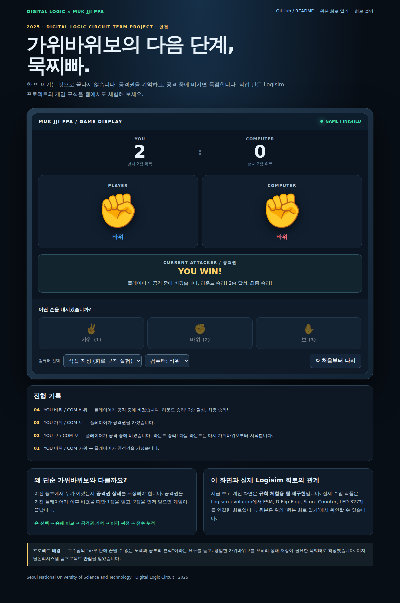

# 묵찌빠 — Digital Logic Circuit Term Project

**2025년 2학기 · 디지털논리시스템 · 개인 텀프로젝트 · Logisim-evolution · 만점**

> **“단순 가위바위보라면 최하점”이라는 말에서 출발해, 오히려 가위바위보를 발전시켜 보자고 생각했습니다.** 공격권을 기억하는 묵찌빠, 3판 2선승, 점수 기록, LED 손 모양과 결과 표시까지 직접 회로로 만들었습니다.

### 🎮 직접 체험하기

**[웹에서 묵찌빠 플레이하기](https://hahyeong12.github.io/mukjjippa-2025-digital-logic/)** · [Logisim 회로 다운로드](circuit/mukjjippa-main.circ) · [회로 구현 설명](docs/implementation.md)

웹 체험 페이지는 공격권·비김·2선승 규칙을 브라우저에서 구현한 버전입니다. **원본 작품은 Logisim-evolution 회로**이며, 웹 데모는 규칙을 바로 이해할 수 있도록 별도로 구성했습니다. GitHub Pages 설정을 활성화하면 위 링크로 접속할 수 있습니다.

**[▶ 브라우저 게임 동작 영상 (MP4)](docs/media/web-demo.mp4)** · [완료된 화면 크게 보기](docs/media/web-demo-final.png)

영상은 웹 체험판을 실제로 플레이한 녹화입니다. 원본 Logisim 회로의 실행 녹화와는 구분합니다.

## 1. 왜 묵찌빠였나?

교수님은 텀프로젝트에서 구현 주제와 난이도는 자유롭게 정하되, **하루 만에 만들 수 없는 작품, 공부와 노력의 흔적이 드러나는 작품**을 기대한다고 하셨습니다. 또 단순 가위바위보를 구현한다면 최하점을 받을 수 있다는 말씀도 하셨습니다.

그 말을 듣고 오히려 **“가위바위보를 출발점으로 삼아 더 복잡한 게임으로 확장하면 어떨까?”** 하는 생각이 들었습니다.

일반 가위바위보는 현재의 손 두 개를 비교하면 끝납니다. 반면 묵찌빠는 **직전 승부의 공격권을 기억**해야 합니다. 여기에 **3판 2선승**, 게임 점수 저장, 최종 승리 표시를 더하면 수업에서 배운 **논리 게이트·D Flip-Flop·FSM·Decoder·Counter**를 하나의 작품 안에서 활용할 수 있었습니다.

## 2. 게임의 규칙과 결과

| 게임 상황 | 회로가 해야 하는 일 |
| --- | --- |
| 사용자와 컴퓨터가 손을 선택 | 각 손을 2비트 값으로 변환하고 저장 |
| 한쪽이 가위바위보 승리 | 승자에게 공격권 부여 |
| 공격권을 가진 쪽이 비김 | 그쪽의 라운드 승리, 점수 1 증가 |
| 다른 쪽이 승리 | 공격권 이동 |
| 먼저 2승 달성 | 최종 승리 결과 LED 점등 |

**최종 결과: 텀프로젝트 만점.**

제출 포스터에는 **공격권 기억, 라운드 판정, 점수 누적과 최종 승리 LED까지 구현한 모습**이 담겨 있습니다.

## 3. 어떻게 만들었나?

~~~mermaid
flowchart TD
    A["플레이어 버튼"] --> PE["Player_Encoder"]
    B["Comp_RNG"] --> CH["Com_Hold"]
    PE --> PH["Player_Hold"]
    PH --> REF["RPS_Reference"]
    CH --> REF
    REF --> FSM["FSM_Controller / 공격권 기억"]
    FSM --> SCORE["Score_Counter × 2"]
    SCORE --> WIN["2승 판정 · 결과 LED"]
    PH --> DISP["Display_Controller"]
    CH --> DISP
    DISP --> LED["LED 손 모양"]
~~~

| 기능 | 구현 회로 | 설계 이유 |
| --- | --- | --- |
| 손 선택 | Player_Encoder / Comp_RNG | 사용자 버튼과 컴퓨터 손 선택을 공통 신호로 처리 |
| 손 모양 기억 | Player_Hold / Com_Hold | 판정 중에도 선택한 손을 유지 |
| 가위바위보 판정 | RPS_Reference | 승·패·무를 PW / CW / Tie로 분리 |
| 공격권과 라운드 | FSM_Controller | **이전 상태를 기억**해 비김을 라운드 승리로 판정 |
| 2선승 점수 관리 | Score_Counter | D Flip-Flop으로 점수를 저장하고 2승 판정 |
| 디스플레이 | Display_Controller / Blink_Gen | LED 손 모양과 승패·결과 점등 |

**[회로별 게이트 구성과 설계 이유 자세히 보기](docs/implementation.md)**

## 4. 가장 어려웠던 부분

**FSM 재설계.** 일반 승패 판정은 됐지만 묵찌빠의 공격권 상태와 라운드 승리를 연결하자 회로가 복잡해졌습니다. **K-Map으로 논리식을 줄이고**, 여러 지점에 **Probe를 연결해 신호를 직접 추적**하면서 FSM을 다시 구성했습니다. 보고서에는 이 문제로 **하루 약 2시간씩 10일 이상** 고민했다고 적었습니다.

**신호 순서와 점수 오류.** 손 저장·승패 판정·점수·FSM 갱신이 어긋나 점수가 0→1→3처럼 건너뛰기도 했습니다. 저장·판정·카운터가 동작하는 순서를 조절하며 해결했습니다.

**직접 그린 LED 화면.** 원하는 그래픽을 사용하기 어려워 **Main에 LED 327개**를 배치해 손 모양과 게임 화면을 만들었습니다. 배선과 Tunnel을 정리하고, 한 손 윤곽에서 가위·바위·보를 다르게 점등하는 방식으로 다듬었습니다.

[**기획 계기와 디버깅 과정 자세히 읽기**](docs/retrospective.md)

## 5. 작품 살펴보기

### 원본 Logisim 회로

1. [Logisim-evolution 3.9.0](https://github.com/logisim-evolution/logisim-evolution/releases/tag/v3.9.0)을 설치합니다.
2. [Main으로 시작하는 회로](circuit/mukjjippa-main.circ)를 내려받아 엽니다.
3. Main의 가위·바위·보 버튼과 게임 진행 버튼을 조작합니다.

[회로 원본](archive/kim_hahyeong_original.circ)도 보존했습니다. 원본에서는 시작 회로가 다른 테스트용 서브회로로 설정돼 있어, 편의를 위해 **Main으로 시작하는 사본**을 함께 제공합니다.

### 발표 포스터 및 플레이 영상

발표 포스터에는 전체 구조, 초기 FSM과 단순화한 회로, 전파 지연 디버깅, LED로 그린 최종 게임 화면을 정리했습니다. **포스터 PDF와 이미지는 GitHub 업로드 후 이 위치에 크게 표시할 예정입니다.**

**[웹 체험판 플레이 영상](docs/media/web-demo.mp4)**과 [완료 화면](docs/media/web-demo-final.png)은 공개돼 있습니다. 당시 제출한 Logisim 원본 실행 영상은 이번 자료에 포함되지 않아 추가하지 않았습니다.

---

서울과학기술대학교 · Digital Logic Systems · 2025
