# 묵찌빠 — Logisim 회로 갤러리

**2025년 2학기 · 디지털논리시스템 · 개인 텀프로젝트 · Logisim-evolution 3.9.0**

이 페이지는 게임을 구성한 **실제 Logisim 회로와 제작 과정의 실험 회로**를 보여줍니다. 이미지는 회로를 읽기 쉽게 모아둔 자료이며, 실제 플레이는 아래 `.circ` 파일로 진행합니다.

**[▶ 실행용 회로 다운로드](mukjjippa-main.circ)** · [2025년 원본 파일](../archive/kim_hahyeong_original.circ) · [프로젝트 메인으로](../README.md)

## 1. Main — 완성된 게임과 전체 연결

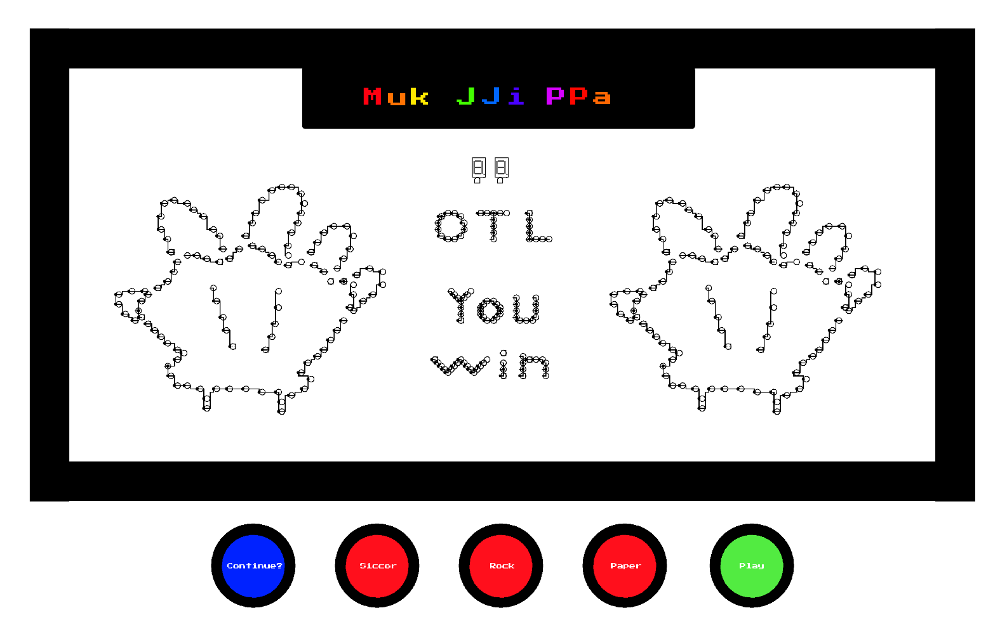

게임 화면은 LED로 손 모양과 결과를 표현하고, 아래의 버튼으로 가위·바위·보와 게임 진행을 조작합니다. **위 이미지는 Main 전체 화면 중 게임 UI 부분만 잘라낸 보기용 이미지**입니다.

<strong>Main 전체 회로와 하단 내부 배선 펼쳐보기</strong>

### Main 전체

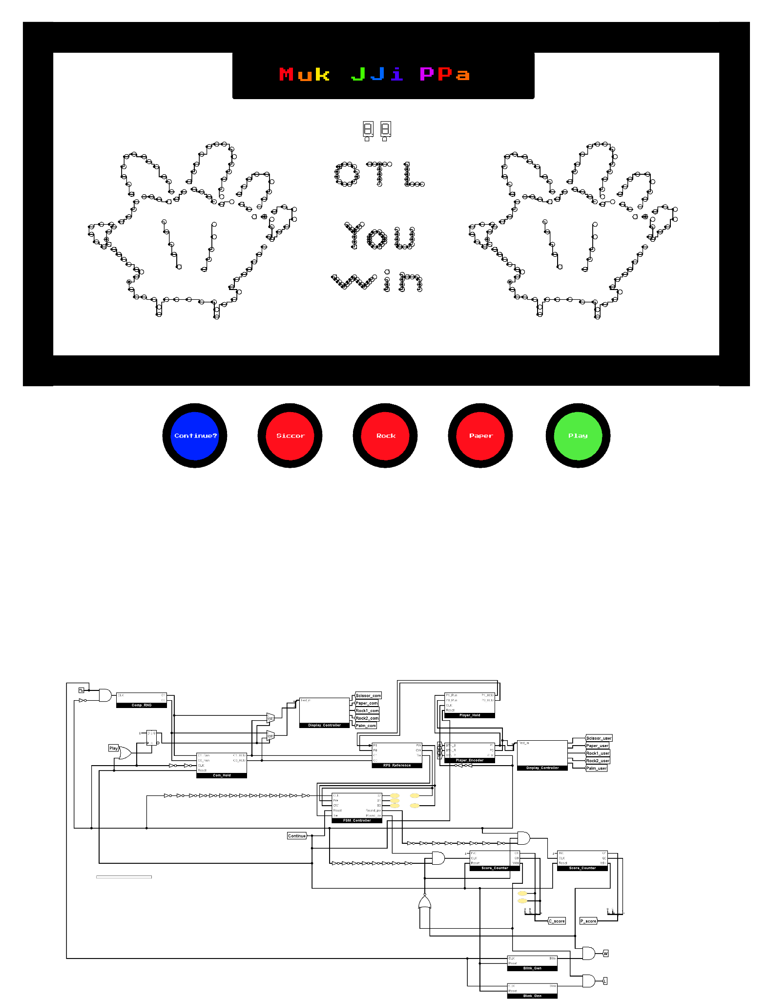

### Main 내부 서브회로 연결 부분

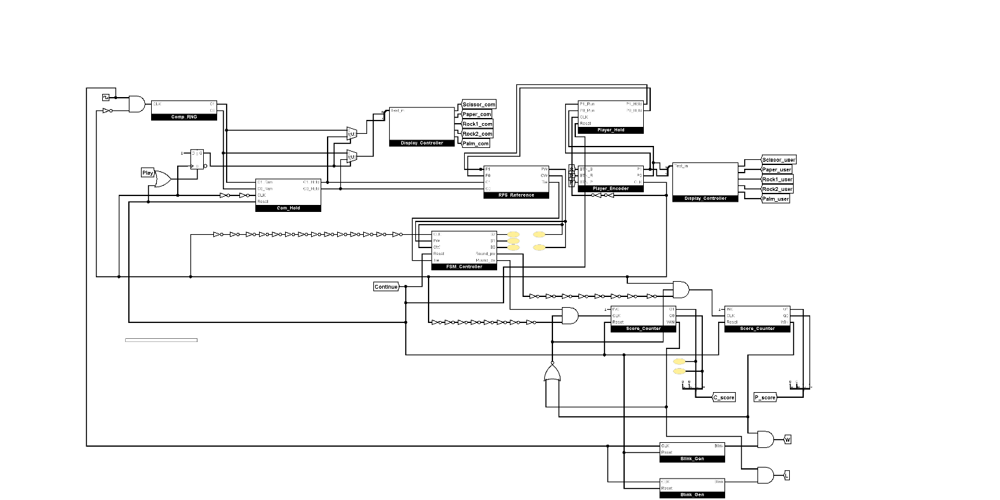

## 2. 전체 동작 흐름

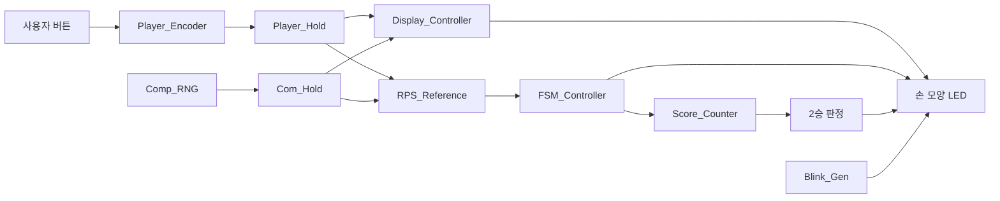

단순 가위바위보와 달리, **묵찌빠는 이전 승부의 공격권을 기억해야 한다**는 점이 핵심입니다. 아래 회로들은 이 역할을 나눠 맡습니다.

## 3. 플레이어와 컴퓨터의 손 생성·저장

### Player_Encoder — 사용자 입력의 2비트 인코딩

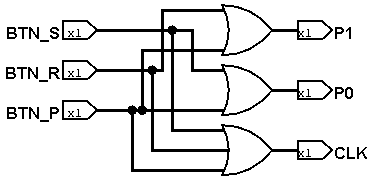

가위·바위·보 버튼의 선택을 `P1`, `P0`의 공통 코드로 변환하고 입력용 클록을 만듭니다.

### Player_Hold — 사용자 선택 기억

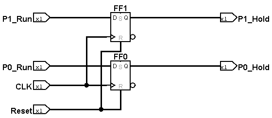

D Flip-Flop 2개로 사용자 손 모양을 저장하여, 판정 중에도 입력이 유지되게 합니다.

### Comp_RNG — 컴퓨터 손 생성

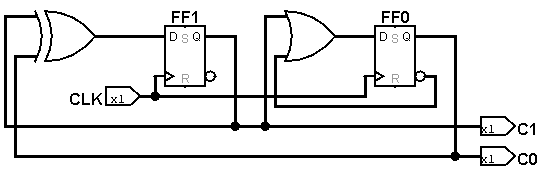

Flip-Flop과 게이트 조합으로 컴퓨터의 손 선택 신호를 생성하는 회로입니다.

### Com_Hold — 컴퓨터 선택 기억

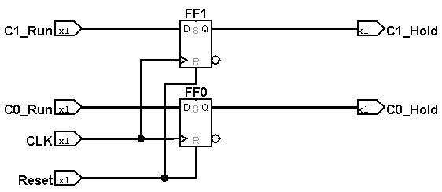

컴퓨터의 선택을 저장해 사용자 손과 같은 시점의 값을 비교할 수 있도록 합니다.

## 4. 승패 판단과 공격권 기억

### RPS_Reference — 가위바위보 승·패·무 판정

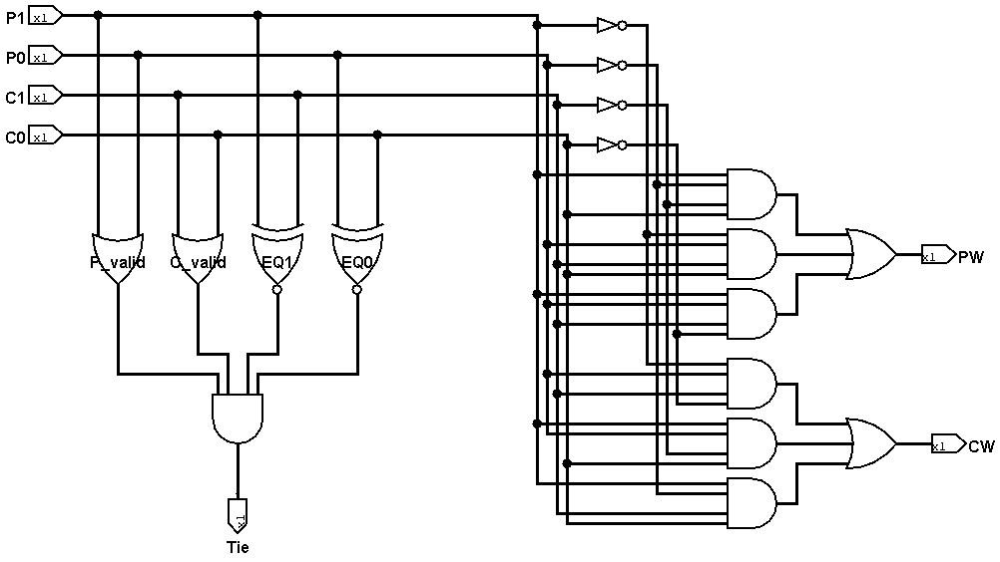

사용자와 컴퓨터의 손 코드로 `PW`(플레이어 승), `CW`(컴퓨터 승), `Tie`(비김)를 판단합니다.

### FSM_Controller — 묵찌빠 규칙의 핵심

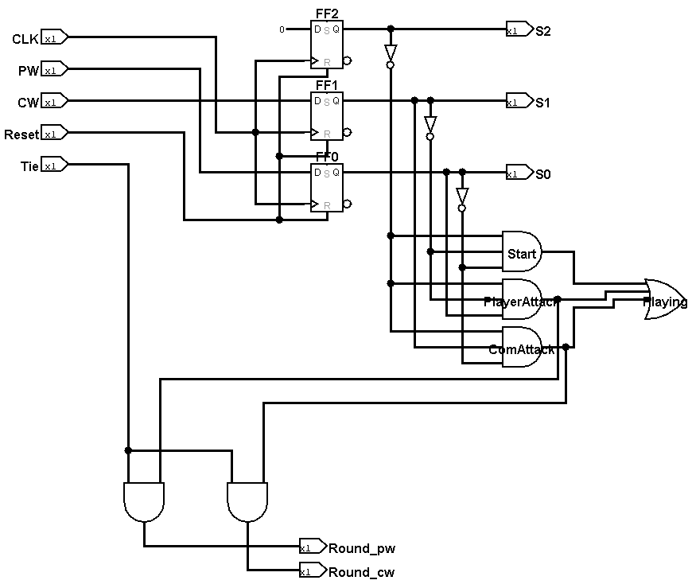

이전 승부의 **공격권 상태**를 Flip-Flop에 기억합니다. 한쪽이 이겨 공격권을 얻고, 그 공격권을 가진 상태에서 비기면 해당 플레이어의 라운드 승리 신호를 만듭니다.

### Score_Counter — 라운드 승점과 최종 승리

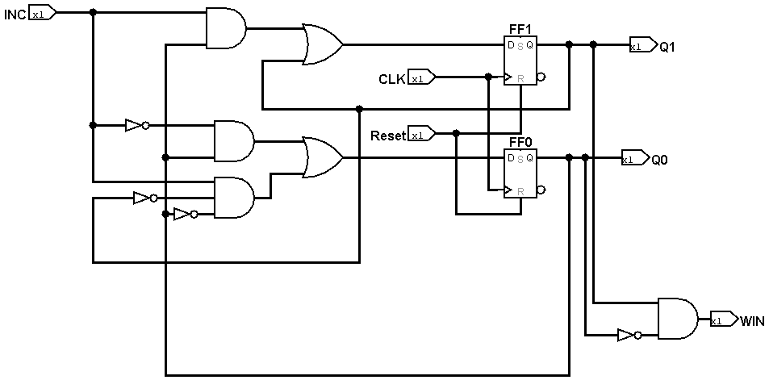

라운드 승리를 점수로 누적하고 2승에 도달하면 `WIN`을 출력합니다. 제작 중에는 점수가 한 번에 여러 단계 올라가는 오류도 관찰해 신호 순서를 조정했습니다.

## 5. 화면 출력과 시각적 표현

### Display_Controller — 손 모양 LED 선택

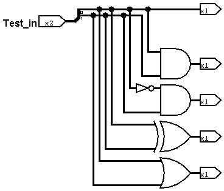

손 코드를 바탕으로 가위·바위·보에 해당하는 LED 출력 패턴을 제어합니다.

### Blink_Gen — 점멸 신호 생성

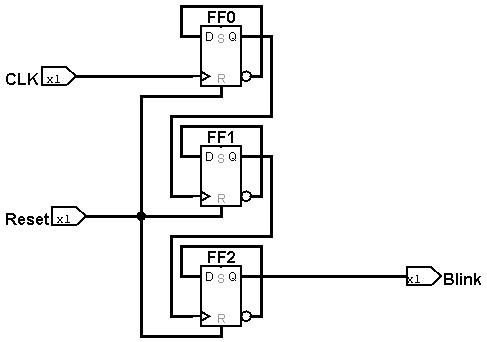

Flip-Flop으로 결과 표시용 점멸 신호를 생성합니다.

### 버튼과 화면용 회로도 프로젝트 안에 포함

`painting`, `Line_Black`, `Title`, `BackGround`, `Button_S`, `Button_R`, `Button_P`, `Button_Play`, `Button_Continue`도 **실제 `.circ` 파일에 들어 있는 별도 회로 정의**입니다. 각 버튼의 별도 PNG가 없더라도 다운로드한 Logisim 프로젝트에서 확인할 수 있습니다. Main 스크린샷은 이 화면 구성까지 함께 보여줍니다.

## 6. 제작 과정에 남긴 실험·대안 회로

원본 `.circ`에는 현재 설명한 주요 회로 외에도 다양한 이름의 실험 회로가 남아 있습니다. **`_rip`와 `GUI_test`는 파일 안에 실제로 존재하는 회로 이름**이며, 여기서는 완성본의 동작을 대신하는 것이 아니라 설계와 시행착오의 기록으로 소개합니다. 이름만으로 정확한 제작 순서를 확정하지는 않습니다.

<strong>FSM 상태 설계 실험 3장 펼쳐보기</strong>

#### FSM_Controller_rip

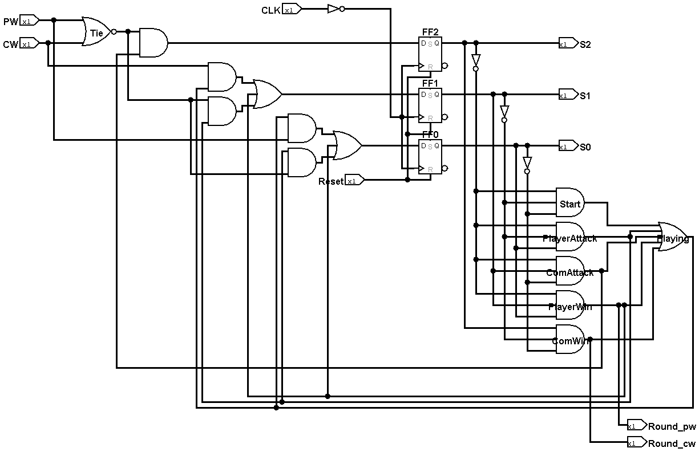

#### FSM_Controller_rip2

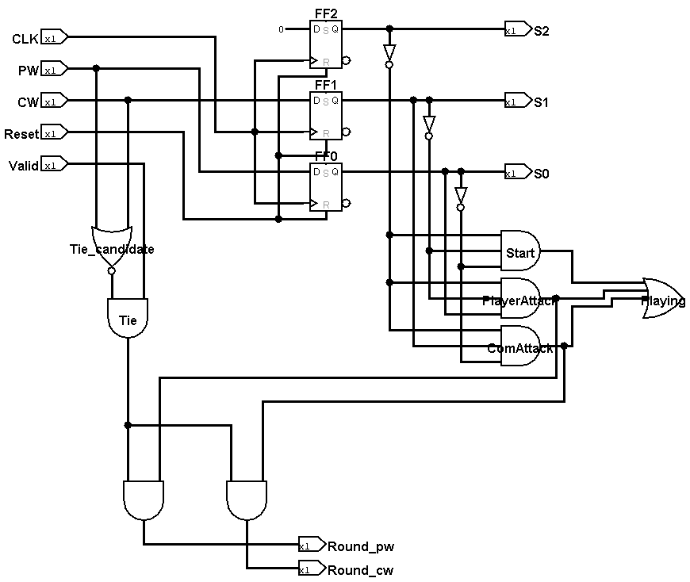

#### fsm_controller_new_rip

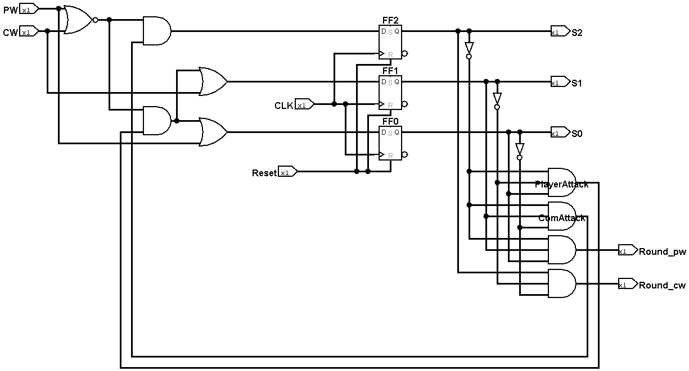

FSM의 상태 저장과 공격권·라운드 판정 논리를 여러 방식으로 구성한 기록입니다. 당시에는 K-Map으로 논리식을 간소화하고 Probe로 신호를 추적하며 문제를 해결하려고 했습니다.

<strong>승패 판정 실험 1장 펼쳐보기</strong>

#### RPS_Reference_rip

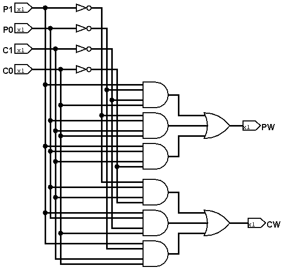

가위바위보 비교 논리의 다른 설계 구성을 보존한 이미지입니다.

<strong>LED 손 모양 구현 실험 3장 펼쳐보기</strong>

#### Scissor_Diplay_rip

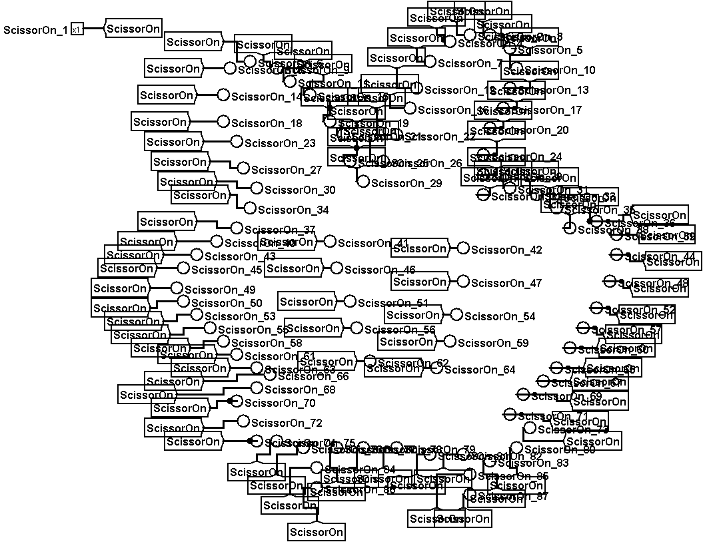

#### Rock_Diplay_rip

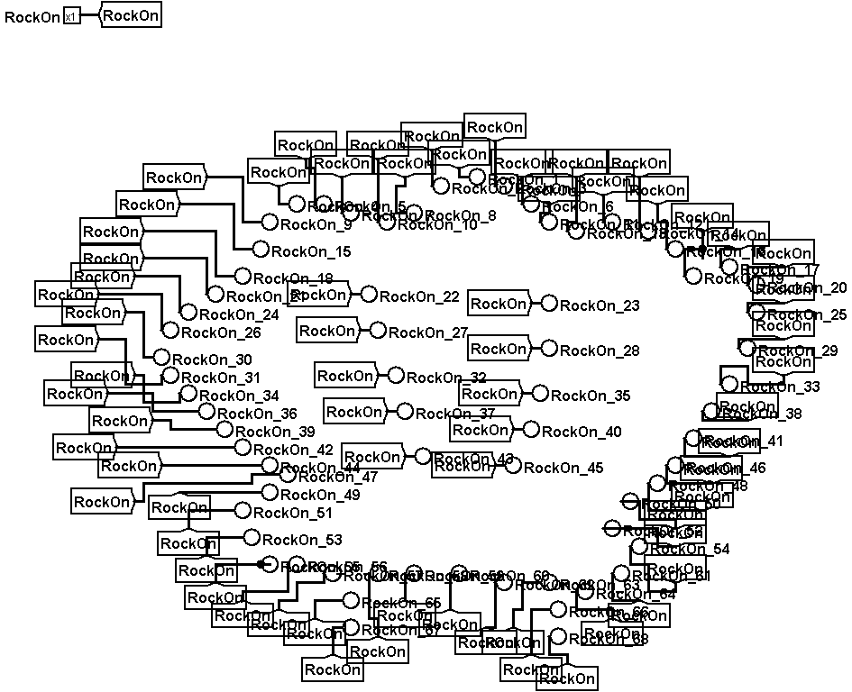

#### Paper_Diplay_rip

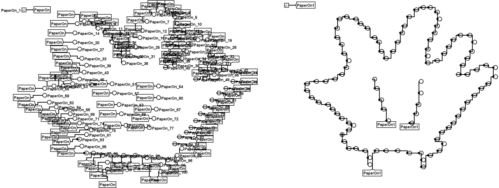

LED를 일일이 배치하고 신호를 연결하면서 손 형태를 구현하려 했던 과정입니다. 배선과 Tunnel 표기가 겹쳐 복잡하게 보이는 상태도 수정 전의 실험 기록으로 보존했습니다.

<strong>GUI_test 초기 화면 실험 1장 펼쳐보기</strong>

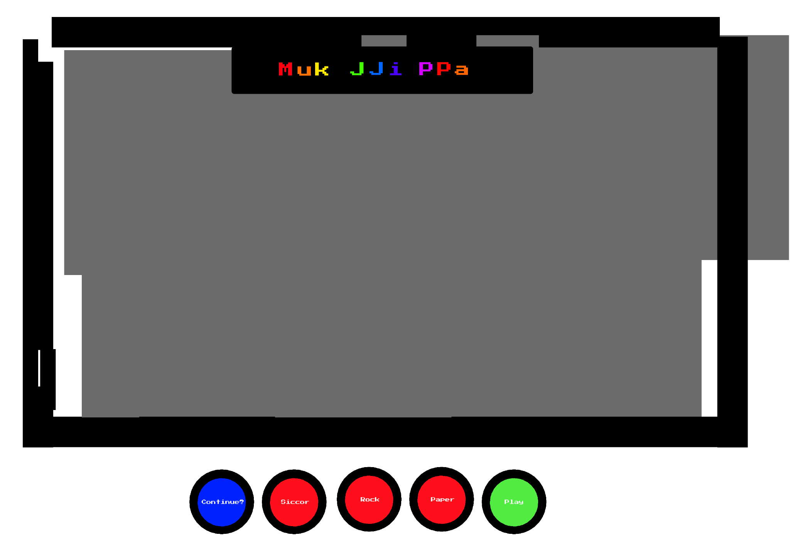

최종 Main 외에 별도 보존된 GUI 구성 테스트 회로입니다.

## 7. 내려받아 직접 실행하기

1. [Logisim-evolution 3.9.0](https://github.com/logisim-evolution/logisim-evolution/releases/tag/v3.9.0)을 설치합니다.
2. **[mukjjippa-main.circ](mukjjippa-main.circ)** 페이지에서 **Download raw file**로 다운로드합니다.
3. Logisim에서 **File → Open**을 선택해 회로 파일을 엽니다.
4. 왼쪽 회로 목록에서 **Main**을 선택하고, 게임 화면의 가위·바위·보 및 진행 버튼을 조작합니다.

> `.circ`는 **여러 Subcircuit을 포함한 하나의 Logisim 프로젝트 파일**입니다. GitHub에서 파일을 직접 클릭했을 때 XML 코드가 표시되는 것은 정상이고, 회로가 빠진 것이 아닙니다.

**보존 원칙:** 이 갤러리는 2026년에 정리한 설명 자료입니다. 당시 실제 회로는 [2025년 제출 원본](../archive/kim_hahyeong_original.circ)에 보존했고, [실행용 사본](mukjjippa-main.circ)은 시작 회로가 Main으로 열리도록 설정한 파일입니다.

← [프로젝트 소개와 시연 영상](../README.md) · [회로별 설계 설명](../docs/implementation.md) · [개발 회고](../docs/retrospective.md)
