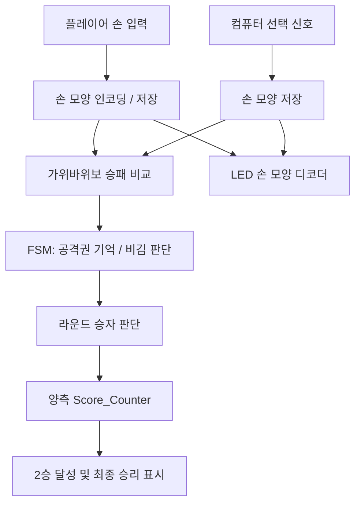

# 묵찌빠 — 회로 구현 설명

> 2025년 제출 포스터·보고서와 Logisim-evolution `.circ` XML을 2026년 11월에 대조한 기록입니다. 회로의 정적 구조와 제출 당시의 완성 설명을 구분하며, **2026년 현재 실제 시뮬레이션 전체 동작을 검증했다고 주장하지 않습니다.**

## 1. 일반 가위바위보에서 순차논리로

일반 가위바위보는 두 손 모양을 비교해 승·패·무승부를 결정합니다. 하지만 **묵찌빠는 직전 대결에서 누구에게 공격권이 있는지 기억해야** 합니다. 공격권을 가진 쪽이 비기면 그쪽이 한 라운드를 이기고, 프로젝트는 **3판 2선승제**까지 구현하려 했습니다.

이 때문에 AND/OR 게이트의 조합만으로 끝내지 않고 **D Flip-Flop, FSM, Hold Register, Counter**가 사용됐습니다.

## 2. 주요 회로별 역할

| 원본 서브회로 | 입력/출력과 역할 |
| --- | --- |
| `Player_Encoder` | BTN_S/BTN_R/BTN_P 버튼을 두 비트 손 코드와 CLK 신호로 변환 |
| `Comp_RNG` | D Flip-Flop과 논리 게이트를 이용해 컴퓨터의 손 선택 신호 생성. 무작위성의 통계적 검증은 하지 않음 |
| `Player_Hold` · `Com_Hold` | 양측 손 모양을 D Flip-Flop으로 저장해 판정 시점에 유지 |
| `RPS_Reference` | 양측 코드에서 Player Win(`PW`), Computer Win(`CW`), Tie 판정 |
| `FSM_Controller` | CLK, PW, CW, Tie, Reset을 받아 공격권/라운드 상태 및 Round_pw, Round_cw 출력 |
| `Score_Counter` | 라운드별 승리 신호를 누적하고 2승 도달 여부(`WIN`) 출력 |
| `Display_Controller` | 손 모양 2비트 코드를 LED 출력으로 변환 |
| `Blink_Gen` | 결과 표시용 점멸 신호 생성 |
| `Main` | 손 모양 LED, 버튼, 결과 표시와 서브회로 연결 |

당시 초기 프롬프트에는 **가위 = 01, 바위 = 10, 보 = 11**이라는 2비트 코딩 규칙이 기록되어 있습니다. 이는 설계 의도이고, 모든 연결의 진리표를 다시 검증한 결과는 아닙니다.

## 3. FSM: 공격권과 라운드 승리

게임의 상태를 기억하는 핵심이 `FSM_Controller`입니다. 일반 승패 판정만으로는 지금 비긴 결과가 승리인지 결정할 수 없습니다. **직전 승부의 공격권과 현재의 Tie**가 결합되어야 라운드 종료를 알 수 있습니다.

초기에는 `PW`·`CW`를 AND/OR 게이트로 여러 번 결합하여 D Flip-Flop에 전달하는 구조가 복잡해졌습니다. 보고서에 따르면 그 상태에서 묵찌빠 판정이 실패했고, K-Map을 이용해 식을 단순화한 뒤 Probe로 각 신호를 추적하면서 수정했습니다.

## 4. 신호 전달 순서: 당시의 주요 난관

포스터에는 `Player_Encoder.CLK`에서 출발한 신호가 손 모양 보관, 판정, 점수, FSM 회로에 도달하는 **순서가 필요했다**고 설명되어 있습니다.

| 회로 경로 | 포스터에 기록된 방식 |
| --- | --- |
| `Player_Hold` / `Com_Hold` | NOT 게이트 2개를 통한 지연 |
| `Score_CLK` | NOT 게이트 8개를 통한 지연 |
| `FSM_CLK` | NOT 게이트 14개를 통한 지연 |

이것은 **2025년 Logisim 프로젝트에서 시도한 해결책**입니다. 실제 물리 회로에서 인버터를 일정 개수 연결하면 정확한 클록 순서나 타이밍이 보장된다는 뜻은 아닙니다. 후속 구현에서는 동기식 클록 구조와 데이터 안정성 조건을 별도로 검증할 필요가 있습니다.

## 5. LED로 구현한 게임 디스플레이

일반 게임 화면이나 오락기 디자인을 가져올 수 없어서 **LED를 하나씩 배치**했습니다. 신호선을 숨기기 위한 Tunnel 방식은 오히려 화면의 완성도를 낮추었고, 최종적으로 신호선을 정리하면서 LED 내부로 터널을 최대한 숨겼다고 포스터에 기록되어 있습니다.

처음에는 가위·바위·보를 별도 손 형태로 구현했지만, 이후 하나의 손 외형에서 켜지는 LED를 바꾸는 방식으로 정리했습니다. 최종 화면에는 양측 손 모양, 버튼, 점수 및 YOU WIN/LOSE 표현이 배치되어 있습니다.

## 6. 회로 개수와 원본 보존

제출 포스터에는 **19개의 Subcircuit과 Main**으로 소개했습니다. 이번에 제공된 원본 XML에는 `Main` 포함 **27개 회로 정의**가 남아 있습니다. 일부는 `_rip`이 붙은 실험·이전 설계 회로이며, 모든 27개가 최종 Main에서 사용된다는 뜻이 아닙니다.

- **원본:** [archive/kim_hahyeong_original.circ](../archive/kim_hahyeong_original.circ)
- **실행 편의 사본:** [circuit/mukjjippa-main.circ](../circuit/mukjjippa-main.circ)

실행용 파일은 프로젝트 기본 회로 선택을 `RPS_Reference_rip`에서 `Main`으로 바꾼 것 외에는 원본과 동일합니다.

## 검증의 범위

회로 원본 및 실행용 사본의 XML 파싱, 회로 27개 정의, 내부 서브회로 참조, 시작 회로 설정을 정적으로 확인했습니다. 게임 전체의 모든 경우에 대해 Logisim GUI에서 승패 판정을 재실행한 것은 아닙니다.

[검증 방법](verification.md) · [개발 회고](retrospective.md)
