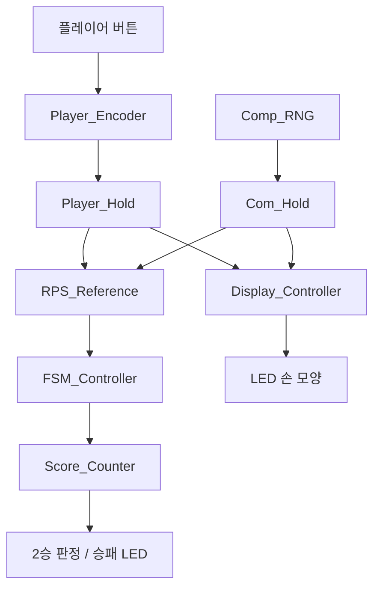
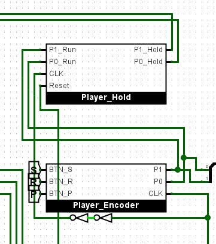
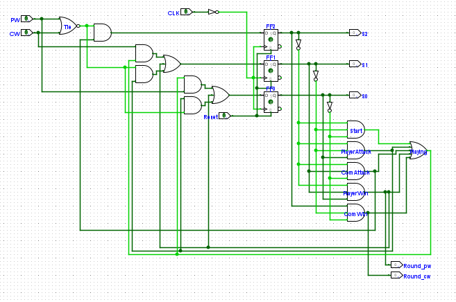
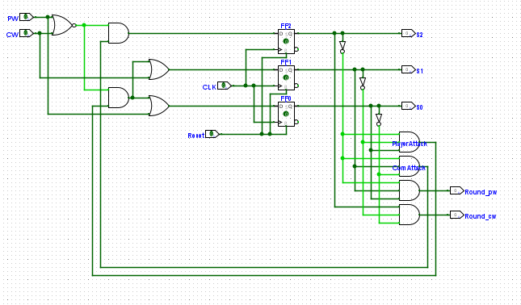
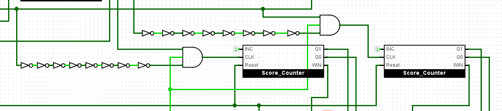
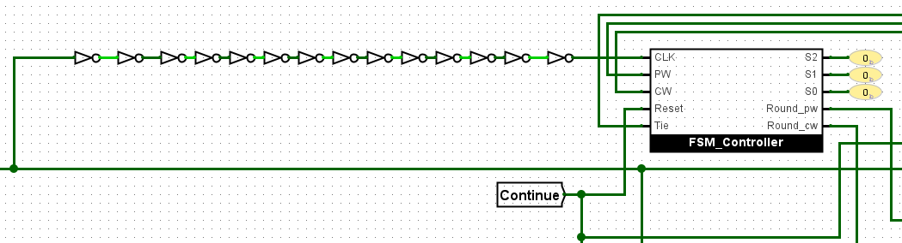
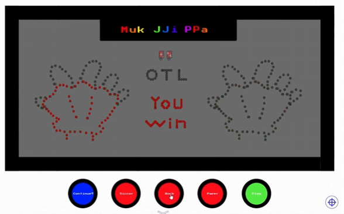
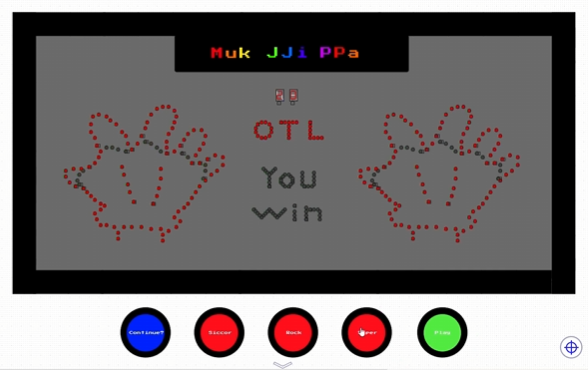

# 묵찌빠 회로 설계와 구현

**Logisim-evolution 3.9.0 · 디지털논리시스템 텀프로젝트**

묵찌빠를 구현하려면 단순한 가위바위보 승패 판정을 넘어 **이전 공격권을 기억하고 라운드별 결과를 누적**해야 합니다. 따라서 게임을 입력·저장·승패 비교·상태 관리·점수·화면 출력으로 나눠 설계했습니다.

## 전체 구성

## 기능별 설계 이유

| 서브회로 | 구현 요소 | 역할 및 설계 의도 |
| --- | --- | --- |
| **Player_Encoder** | 버튼 3개, 2비트 손 코드, CLK | 플레이어의 가위·바위·보 버튼을 각 회로가 공통으로 처리할 수 있는 신호로 변환 |
| **Comp_RNG** | D Flip-Flop 2개 및 논리 게이트 | 컴퓨터 측 손 선택 신호를 회로 내부에서 생성 |
| **Player_Hold / Com_Hold** | 각각 D Flip-Flop 2개 | 그 턴에서 선택한 손 모양을 저장해 판정 중 유지 |
| **RPS_Reference** | 조합논리, PW·CW·Tie 출력 | 두 손의 승패를 계산하는 회로를 별도 분리 |
| **FSM_Controller** | D Flip-Flop 3개, 상태 논리 | 현재 가위바위보 결과와 이전 공격권을 결합해 라운드 종료 판단 |
| **Score_Counter** | D Flip-Flop 2개, INC·WIN 신호 | 승점을 누적해 2승 달성을 판정 |
| **Display_Controller** | 디코더와 논리 게이트 | 손 모양 코드를 LED 점등 패턴으로 변환 |
| **Blink_Gen** | D Flip-Flop 및 점멸 신호 | 승리/패배 표시용 점멸 효과 |
| **Main** | LED 327개, 버튼 및 각 서브회로 | 입력부터 최종 승리 화면까지 한곳에서 조작하고 확인 |

### 1. 입력을 두 비트로 표현하기

가위는 `01`, 바위는 `10`, 보는 `11`로 통일했습니다.

`Player_Encoder`는 버튼 입력을 이 두 비트 정보로 변환하고, `Comp_RNG`에서는 컴퓨터 손을 선택합니다. 이후 `Player_Hold`와 `Com_Hold`가 선택된 손을 저장합니다.

그 이유는 **선택한 손의 정보가 다음 회로에서 판정되는 동안 변하지 않도록 하기 위해서**입니다.

### 2. 일반 가위바위보 판정

`RPS_Reference`는 양측 두 비트 코드를 비교해 세 개의 신호를 생성합니다.

- `PW`: Player Win
- `CW`: Computer Win
- `Tie`: 비김

여기까지는 조합논리로 구현할 수 있지만, **묵찌빠에서는 `Tie`만으로 승리 여부를 알 수 없습니다.** 누가 공격 중이었는지를 알아야 합니다.

### 3. 공격권을 기억하는 FSM

`FSM_Controller`에서는 D Flip-Flop을 이용해 공격권과 관련된 상태를 기억합니다. 가위바위보에서 이긴 쪽이 공격권을 갖고, 다음 승부에서 비기면 공격권을 가진 쪽이 라운드를 이깁니다.

| 상황 | 라운드 처리 |
| --- | --- |
| 공격권 없음 + 비김 | 라운드 진행 |
| 플레이어 가위바위보 승리 | 플레이어 공격권 획득 |
| 컴퓨터 가위바위보 승리 | 컴퓨터 공격권 획득 |
| 플레이어 공격 중 비김 | 플레이어 라운드 승리 |
| 컴퓨터 공격 중 비김 | 컴퓨터 라운드 승리 |

처음 FSM을 구성할 때는 입력 신호를 여러 AND·OR 게이트로 연결해 회로가 복잡해졌습니다. 어느 위치에서 판정이 어긋나는지 찾기 어려워, **K-Map으로 논리식을 단순화한 뒤 회로를 다시 설계**했습니다.

<blockquote>
초기 FSM 설계
</blockquote>

<blockquote>
K-Map을 이용해 다시 구성한 FSM
</blockquote>

그리고 **Probe를 회로의 여러 지점에 연결**해 각 신호가 의도대로 전달되는지 직접 추적했습니다.

### 4. 점수 저장과 최종 승리

묵찌빠 한 라운드에서 승리하면 `Round_pw` 또는 `Round_cw`가 발생하고, 각 플레이어의 `Score_Counter`가 점수를 누적합니다. 먼저 **2승**을 얻은 쪽이 게임 전체의 승자로 확정되도록 구성했습니다.

처음에는 점수가 `0 → 1 → 3`처럼 증가하거나 컴퓨터 쪽이 `0 → 1 → 2 → 4`로 건너뛰는 문제가 있었습니다. **승리 신호가 올바르게 계산되는 것만으로는 충분하지 않고, 저장되는 시점도 맞아야** 했습니다.

### 5. 손 모양 저장과 점수·FSM의 신호 순서

손 모양을 보관하는 경로와 점수를 기록하는 경로, FSM이 상태를 갱신하는 경로는 신호가 전달되는 타이밍에 영향을 받았습니다.

제출 포스터에는 NOT 게이트를 연결해 신호 지연을 조절했던 구성이 남아 있습니다.

| 경로 | 적용한 NOT 게이트 |
| --- | ---: |
| Player_Hold / Com_Hold | 2개 |
| Score_CLK | 8개 |
| FSM_CLK | 14개 |

이는 당시 **Logisim 회로에서의 타이밍 문제를 해결하기 위해 시도한 방법**입니다.

### 6. LED로 구현한 게임 화면

일반적인 프로그램 화면처럼 게임 이미지를 띄우기 어려웠기 때문에 직접 **LED를 하나씩 배치**했습니다. 초기에는 가위·바위·보를 각각 다른 손으로 그렸지만, 이후 **한 손의 형태에서 점등되는 LED만 바뀌도록** 구성했습니다.

연결선을 안 보이게 하려고 Tunnel을 사용했다가 화면이 더 복잡해져 배선도 다시 조정했습니다.

  
  

## 실제 작품 자료

[제출 포스터 PDF](submission/poster.pdf) · [포스터 이미지](../assets/poster-preview.jpg) · [실행용 Logisim 회로](../circuit/mukjjippa-main.circ) · [개발 과정](retrospective.md)

2025년 발표 포스터에는 **Main과 19개의 Subcircuit**으로 구성했다고 설명했습니다. 제공된 Logisim 원본 파일 전체에는 실험 과정에서 만든 회로를 포함해 27개 정의가 남아 있습니다.
